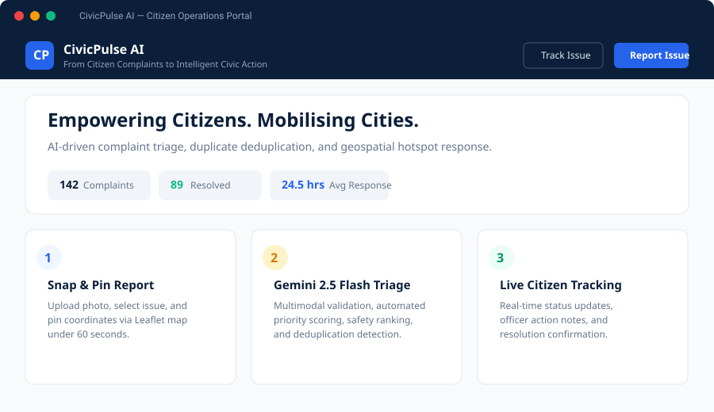
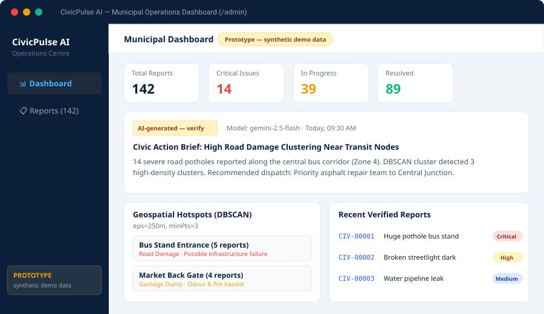

# CivicPulse AI

> *"From Citizen Complaints to Intelligent Civic Action."*

[](https://github.com/basavarajinamati2008-code/AstraSolver/actions/workflows/ci.yml)
[](LICENSE)
[](https://ai.google.dev/)

Built for **PromptWars x ASTRA — AI for Civic Impact** (Problem Track: *From Complaints to Action*).

CivicPulse AI bridges the gap between raw citizen frustration and structured municipal mobilization. It empowers citizens to report street hazards, drainage failures, and public emergencies in under 60 seconds with photos and map coordinates, while giving municipal operations centers real-time multimodal AI triage (powered by Gemini 2.5 Flash), automated spatial deduplication, DBSCAN geospatial hotspot detection, and actionable AI civic action briefs.

---

## Visual Preview

| Citizen Operations Portal | Municipal Dashboard & Geospatial Hotspots |
|:---:|:---:|
|  |  |

---

## 1. System Architecture

```text
[ Citizen Portal (Mobile-First / React) ]          [ Municipal Dashboard (/admin) ]
        |                   |                                    |
   Report Issue         Track Status                      Operations Analytics
   (Leaflet Pin)      (track_report RPC)                 (Hotspots & Recharts)
        |                   |                                    |
        v                   v                                    v
+--------------------------------------------------------------------------------+
|                         Supabase Postgres (Database & Auth)                   |
|  - reports (RLS protected — anonymous direct queries blocked)                 |
|  - report_updates (Audit History with sensitivity flags)                       |
|  - briefs (AI Brief Cache)                                                     |
|  - Storage: report-images (Public read, max 5 MB image upload)                 |
+--------------------------------------------------------------------------------+
        ^                                                        ^
        |                                                        |
+--------------------------------------------------------------------------------+
|                   Supabase Edge Functions (Deno / TypeScript)                  |
|                                                                                |
|  1. submit-report (Public with sliding-window IP rate limiting & input bounds) |
|     Input Validation -> Gemini 2.5 Flash -> Pure Algorithms -> DB Write       |
|                                                                                |
|  2. hotspots (Admin JWT Authenticated)                                         |
|     DBSCAN Clustering (eps=250m, minPts=3) over open reports                   |
|                                                                                |
|  3. civic-brief (Admin JWT Authenticated)                                      |
|     Aggregates stats -> Gemini Brief Synthesis -> Stored in briefs             |
+--------------------------------------------------------------------------------+
        |
        v
[ Google Gemini API (gemini-2.5-flash) ]
  - Structured JSON Output Schema
  - Risk categorization: Safety, Urgency, Public Impact
```

---

## 2. Core Features

* **⚡ 60-Second Mobile Reporting:** Clickable Leaflet pin placement, automatic reverse coordinates, image uploads up to 5 MB, category selection, and affected count.
* **🤖 Transparent AI Triage:** Structured classification with `gemini-2.5-flash`, priority scores (0–100), transparent `"AI-generated — verify"` badges, and graceful fallback states on model failure.
* **🔁 Multi-Factor Duplicate Detection:** Integrates TF-IDF text similarity, spatial distance decay ($\le 500\text{m}$), and category matching to prevent duplicate work while preserving full citizen traceability.
* **📍 DBSCAN Geospatial Hotspots:** Unsupervised spatial clustering identifies systemic infrastructure failures ($\text{eps}=250\text{m}, \text{minPts}=3$) without hardcoded vendor rules.
* **🛡️ Officer Priority Override:** Allows municipal supervisors to adjust priority levels with mandatory written justification, recorded in audit logs and visible on timelines.
* **📡 Real-Time Citizen Tracking:** Direct `supabase.channel` websocket listener updates citizen timelines live as municipal officers assign teams and post progress notes.
* **📊 Comprehensive Operations Center:** Filterable reports table, one-click CSV export, priority donut charts, category histograms, and 14-day trend graphs.

---

## 3. NLP Duplicate Detection Benchmark (30 Pairs)

Evaluated using `node eval/run-eval.mjs` against 30 ground-truth civic complaint pairs (`eval/duplicate_pairs.json`):

### Results at Active Configured Threshold ($\tau = 0.70$)
* **Precision:** **100.0%** (0 False Positives — zero unrelated complaints falsely merged)
* **Recall:** **53.3%** (8 True Positives, 7 False Negatives)
* **F1 Score:** **69.6%**
* **Accuracy:** **76.7%** (23 / 30 pairs correctly predicted)

### Operating Threshold Sensitivity Analysis
| Threshold ($\tau$) | Precision | Recall | F1 Score | Accuracy | True Positives | False Positives | False Negatives | True Negatives |
|:---:|:---:|:---:|:---:|:---:|:---:|:---:|:---:|:---:|
| 0.45 | 100.0% | 100.0% | 100.0% | 100.0% | 15 | 0 | 0 | 15 |
| 0.50 | 100.0% | 100.0% | 100.0% | 100.0% | 15 | 0 | 0 | 15 |
| 0.55 | 100.0% | 100.0% | 100.0% | 100.0% | 15 | 0 | 0 | 15 |
| 0.60 | 100.0% | 66.7% | 80.0% | 83.3% | 10 | 0 | 5 | 15 |
| 0.65 | 100.0% | 53.3% | 69.6% | 76.7% | 8 | 0 | 7 | 15 |
| **0.70 \*** | **100.0%** | **53.3%** | **69.6%** | **76.7%** | **8** | **0** | **7** | **15** |
| 0.75 | 100.0% | 33.3% | 50.0% | 66.7% | 5 | 0 | 10 | 15 |

*\* Configured threshold in `config/civicpulse.config.ts`. The 7 false negatives at 0.70 demonstrate the classic lexical vocabulary gap of pure bag-of-words token overlap (e.g. "crater" vs "pothole"). See [LIMITATIONS.md](LIMITATIONS.md) for detailed analysis.*

---

## 4. Configuration & Adaptability

All core parameters are consolidated into a single source of truth (`config/civicpulse.config.ts` and `supabase/functions/_shared/config.ts`):
* Gemini Model: `gemini-2.5-flash`
* Priority weights: Safety (40), Public Impact (25), Urgency (20), Affected Population (15)
* Duplicate weights: Text Cosine (0.45), Category (0.20), Distance Proximity (0.35)
* DBSCAN parameters: Radius $\text{eps} = 250\text{m}$, $\text{minPts} = 3$
* Max image size: 5 MB (JPEG, PNG, WebP)

For customizing city boundaries, departments, and categories, consult [docs/ADAPTING.md](docs/ADAPTING.md). For HTTP and RPC API specifications, see [docs/API.md](docs/API.md).

---

## 5. Security & Access Control

* **Row-Level Security (RLS):** Direct table queries from the `anon` key to `reports` and `report_updates` are completely denied.
* **Sanitized Public RPCs:** Citizens query status exclusively via the `SECURITY DEFINER` function `track_report(code)`, which prevents table scanning and strips private officer data.
* **Edge Function Auth Guards:** `hotspots` and `civic-brief` verify administrative user Bearer JWTs; unauthenticated calls return `401 Unauthorized`.
* **Abuse & Rate Limits:** `submit-report` enforces a sliding-window rate limit (10 submissions per 5 minutes per IP address), payload size restrictions, and whitelist validation.
* **No Secrets Committed:** No service-role keys, Gemini API keys, or passwords exist in frontend code or git history.

---

## 6. How to Run Locally

### Prerequisites
* Node.js v20+
* npm or pnpm

### Quick Local Preview
A zero-dependency standalone Node preview server is included:
```bash
node server.mjs
```
Open [http://localhost:5173](http://localhost:5173).

### Standard Development
```bash
# 1. Install dependencies
npm install

# 2. Run Vite dev server
npm run dev
```

### Running Test Suites
```bash
# Pure logic test suite (Haversine, TF-IDF, Duplicate Detection, Scoring, DBSCAN)
node tests/runner.mjs

# Security & RLS verification suite
node tests/test-security.mjs

# Configuration anti-drift verification suite
node tests/config-drift.test.mjs

# Duplicate detection benchmark (30 pairs)
node eval/run-eval.mjs

# 14-Step End-to-End Civic Lifecycle Simulation
node tests/test-e2e-journey.mjs
```

---

## 7. Database Setup & Deployment

### 1. Database Schema
1. In the Supabase Dashboard -> **SQL Editor**, paste and run `supabase/migrations/20241030000001_initial_schema.sql`.
2. Storage bucket `report-images` is created automatically with public read policies and 5 MB file size constraints.

### 2. Create Municipal Admin User
In your **Supabase Dashboard -> Authentication -> Users**:
1. Click **Add User** -> **Create User**.
2. Enter your municipal officer email and secure password.
3. Use these credentials to sign in at `/admin/login`.

### 3. Deploy Edge Functions
```bash
# Set Gemini API key secret in Supabase
supabase secrets set GEMINI_API_KEY="your-gemini-key"

# Deploy functions
supabase functions deploy submit-report --no-verify-jwt
supabase functions deploy hotspots
supabase functions deploy civic-brief
```

### 4. Deploy Frontend (Vercel)
1. Import repository into [Vercel](https://vercel.com).
2. Framework Preset: **Vite**
3. Configure Environment Variables:
   * `VITE_SUPABASE_URL`
   * `VITE_SUPABASE_ANON_KEY`
4. Deploy. `vercel.json` provides client-side SPA routing rewrites.

---

## 8. 14-Step End-to-End Demo Script

| Step | Action | Expected Behavior |
|:---:|:---|:---|
| **1** | Open `/` (Landing Page) | View branding, civic metrics counter, and 3-step guide. |
| **2** | Click **Report an Issue** | Opens mobile-first `/report` form. |
| **3** | Click map near Central Bus Stand | Lat/Lng coordinates populate; optional landmark description entered. |
| **4** | Type description of deep pothole | Live validation tracks character constraints. |
| **5** | Submit complaint | Image uploaded to Supabase Storage; `submit-report` executes. |
| **6** | View Success Screen | Unique code generated (`CIV-00001`), AI tags displayed with `AI-generated — verify` badge. |
| **7** | Submit 2nd complaint nearby | Neighbor reports the same pothole with rephrased wording 35m away. |
| **8** | Duplicate Alert Triggered | System detects confidence $\ge 0.70$, links duplicate to primary, preserves both records. |
| **9** | Open `/admin/login` | Sign in with authorized municipal administrator credentials. |
| **10** | Overview Dashboard | Priority distribution, category breakdown, and 14-day complaint trends render. |
| **11** | Hotspot Map / List | DBSCAN groups 3+ nearby open complaints (*"Possible infrastructure issue, inspection recommended"*). |
| **12** | AI Civic Action Brief | Click **Regenerate Brief** to generate Gemini 2.5 Flash operational dispatch advisory. |
| **13** | Reports Table & Override | Filter table, test one-click CSV export, open report detail, adjust priority with mandatory reason. |
| **14** | Open `/track` as Citizen | Search `CIV-00001` — realtime WebSocket updates display new officer note and department assignment. |

---

## License

This project is licensed under the [MIT License](LICENSE).
